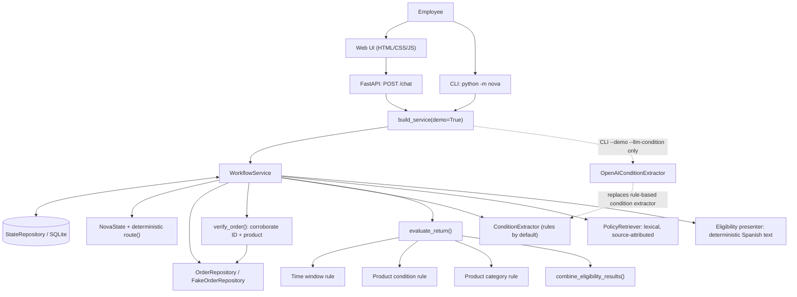

# Nova V1 — Architecture

> Status: **Implemented local pilot architecture (Session 14 documentation consolidation).**
>
> Scope: fictional retail return-assistance workflow. Nova recommends a result to an employee; it **does not authorize, approve, or execute** a real return. This document describes implemented behavior, not a production deployment.

## 1. Architecture at a glance

Nova uses a workflow-first design. The HTTP and CLI entry points construct a `WorkflowService`, which loads conversation state, interprets the employee's message, routes the workflow, invokes narrowly scoped business components, and persists the updated state. Business eligibility is computed by deterministic Python rules; language interpretation is a separate concern.



The diagram is conceptual: `build_service` wires dependencies at startup rather than processing each incoming message. Components are modules in the existing `nova/` package, not separate deployed services.

## 2. Entry points and composition

- `nova/api.py`: FastAPI application factory `create_app()`, browser UI at `/` and `/ui/*`, `POST /chat`, and `GET /health`. The health endpoint reports process liveness, not downstream readiness.
- `nova/__main__.py`: CLI entry point and `build_service()` composition root. The API constructs the **demo** configuration by default, using the `NOVA_DB_PATH` environment variable when set.
- Basic CLI (`python -m nova`): SQLite state and deterministic workflow without the fictional order/evaluation adapters.
- Demo CLI (`python -m nova --demo`): SQLite, fictional orders, deterministic return evaluation, rule-based condition extraction, and lexical policy retrieval.
- Optional CLI (`python -m nova --demo --llm-condition`): substitutes `OpenAIConditionExtractor` for condition interpretation. Requires appropriate OpenAI configuration and may incur API charges.
- The `OpenAIIntentModel` and `IntentClassifier` exist as code, but `build_service()` does **not** inject an intent classifier in these default configurations. Do not describe OpenAI intent classification as active in the web demo.

## 3. Application workflow and state

`nova/service.py` owns the application-level `WorkflowService.handle_message(conversation_id, message)` orchestration:

1. Load the state from `StateRepository` or initialize a `NovaState`.
2. Handle explicit policy questions through the lexical retriever when configured; otherwise continue the active return workflow or route the message.
3. For a return, collect a provisional order ID, request a product description, and corroborate against the fictional order record before confirming the ID.
4. Collect product condition; request clarification if extraction is ambiguous.
5. Evaluate the return with deterministic business rules and render a Spanish recommendation.
6. Save the conversation state and return the response.

`nova/workflow.py` defines `NovaState`, `Status` (`ACTIVE`, `SUSPENDED`, `CANCELLED`), `Step`, and the deterministic `route()` function. Policy questions can suspend an active return, which can later be resumed. The workflow has explicit state transitions; it is not an autonomous LLM agent.

The persisted fields are `intent`, `order_id`, `next_step`, `status`, and `pending_order_id`. Reusing a `conversation_id` allows the backend to recover that state. This is **workflow-state persistence**, not a complete transcript or LLM conversational-memory system.

## 4. Order corroboration and deterministic decision rules

`nova/orders.py` defines the `OrderRepository` protocol, `FakeOrderRepository`, and `verify_order()`. The demo uses fictional orders, including `83921` (audífonos) and `65042` (televisor). A valid-looking order ID is **provisional** until corroborated against order details. The verification contract returns `MATCH`, `MISMATCH`, `NOT_FOUND`, or `NEED_MORE_DETAILS`. Corroboration is neither identity verification nor authorization.

`nova/return_evaluator.py` independently evaluates:
- **Plazo**: `evaluate_return_eligibility()` in `nova/eligibility.py`.
- **Condición**: `evaluate_product_condition()` in `nova/product_condition.py`.
- **Categoría**: `evaluate_product_category()` in `nova/product_category.py`.

`nova/eligibility_engine.py` combines these into a `CombinedEligibilityResult`, retaining individual rule evaluations. Precedence is:

```text
NOT_ELIGIBLE > NEEDS_REVIEW > ELIGIBLE
```

Any confirmed failure produces `NOT_ELIGIBLE`; otherwise uncertainty produces `NEEDS_REVIEW`; otherwise all evaluated rules are favorable. With zero rule evaluations, the result is `NEEDS_REVIEW`. The LLM does **not** determine eligibility. `nova/eligibility_presenter.py` formats the recommendation; no return transaction is executed.

## 5. Language interpretation and policy lookup

- `nova/condition_extraction.py` provides `ConditionExtractor` and conservative `RuleBasedConditionExtractor`. Uncertain, negated, or conflicting descriptions trigger clarification rather than a guessed condition.
- `nova/openai_condition_extractor.py` is an **opt-in** alternative for condition interpretation in the CLI demo. Its output is input to deterministic evaluation, not an authorization.
- `nova/intent_classifier.py` defines a structured JSON intent-classification contract and an OpenAI adapter. These are implemented but **not wired by default** through `build_service()`.
- `nova/policy_retrieval.py` uses keyword overlap over a small, local set of fictional policy passages. It returns source identifiers and abstains or asks for clarification when evidence is insufficient or tied. This is **lexical retrieval, not semantic retrieval or a full RAG pipeline**.

Experimental semantic retrieval, evidence-verifier implementations, and evaluation scripts in `nova/` are separate from the default web chat path. Their presence in the repository must not be interpreted as production integration. The V3 evidence verifier has not been approved for integration into V1.

## 6. Persistence and deployment boundaries

`nova/repository.py` defines `StateRepository` with `load()` and `save()`, plus in-memory and SQLite implementations. SQLite creates a `conversation_states` table and upserts state by `conversation_id`. The current SQLite adapter is **not designed for concurrent multi-worker writes**.

The V1 demo runs locally with FastAPI and can be containerized using the repository's Docker setup. A browser refresh can start a new conversation ID, so the UI does not necessarily restore a prior conversation even though the backend can load state when given the same ID.

No real customer/order integrations, return execution, employee authentication/authorization, production-grade secrets management, concurrency strategy, retention policy, or end-to-end operational observability are claimed here.

## 7. Architectural decisions and trade-offs

| Decision | Rationale | Current trade-off |
| --- | --- | --- |
| Workflow-first orchestration | Explicit, testable control of high-impact business steps | Less open-ended flexibility than an autonomous agent |
| Deterministic eligibility | Reproducible decisions and visible precedence | Rules must be maintained explicitly |
| Interpretation separate from decisions | LLM or rules can interpret language without granting decision authority | Clarification is needed for ambiguous inputs |
| Repository protocols | Swap local implementations for future adapters | Current order data is fictional; SQLite is single-instance oriented |
| Provisional order verification | Avoid treating a typed ID as confirmed evidence | Not a substitute for real identity/authorization controls |
| Lexical policy baseline | Small, explainable, source-attributed pilot | Limited recall; not semantic RAG |
| Optional LLM adapter | Core demo remains usable without external model calls | Default web chat does not demonstrate LLM condition extraction |

## 8. Validation and evolution

Session 13 added end-to-end regression coverage for return flows, interruptions, order corroboration, eligibility boundaries, and SQLite persistence across API instances. After its merge into `main`, the project test suite was reported as **242 passed, 1 nonblocking warning**.

**Session 14:** consolidate this architecture, README, and backlog documentation without changing runtime behavior.

**Session 15:** prepare a reproducible local demonstration, with setup instructions and realistic, clearly fictional scenarios.

**Later, separate production-like cloud phase:** evaluate AWS/Azure hosting, CI/CD, authentication, secrets/configuration, persistent storage suitable for concurrency, logging/metrics/tracing, retention, security, and cost. These are **future design decisions**, not implemented V1 capabilities. Any LLM evidence-verifier integration requires further evaluation and explicit approval; it is not part of the current default chat workflow.

## 9. Source map

- Composition and HTTP: `nova/__main__.py`, `nova/api.py`
- Orchestration and state machine: `nova/service.py`, `nova/workflow.py`
- Persistence: `nova/repository.py`
- Orders: `nova/orders.py`, `nova/order_details.py`
- Business rules: `nova/return_evaluator.py`, `nova/eligibility.py`, `nova/eligibility_engine.py`, `nova/product_condition.py`, `nova/product_category.py`
- Interpretation: `nova/intent_classifier.py`, `nova/condition_extraction.py`, `nova/openai_condition_extractor.py`
- Policy baseline: `nova/policy_retrieval.py`
- Regression and plans: `docs/22-session-13-e2e-regression.md`, `docs/25-nova-v1-backlog.md`
